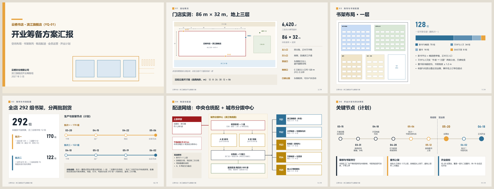
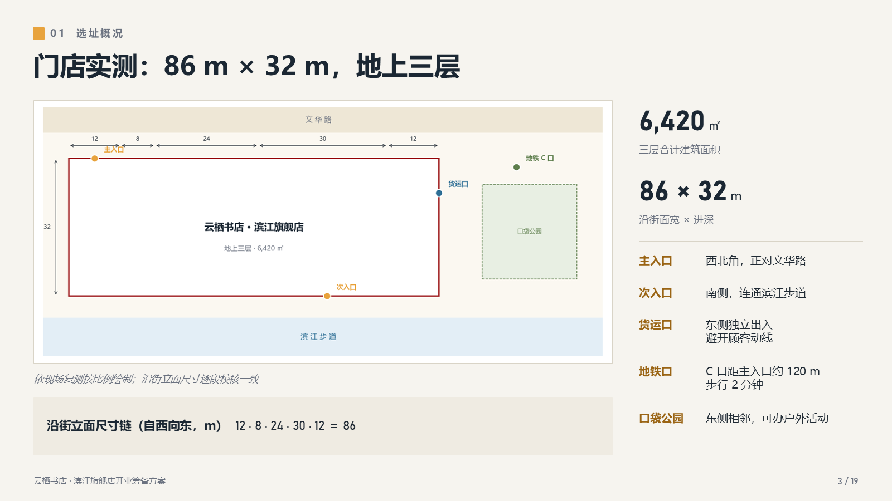
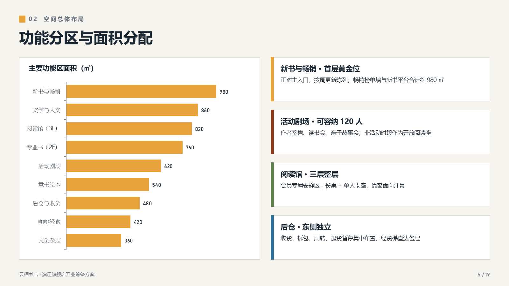
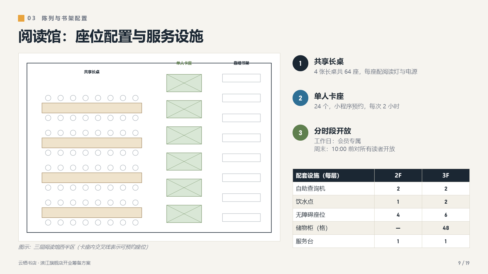
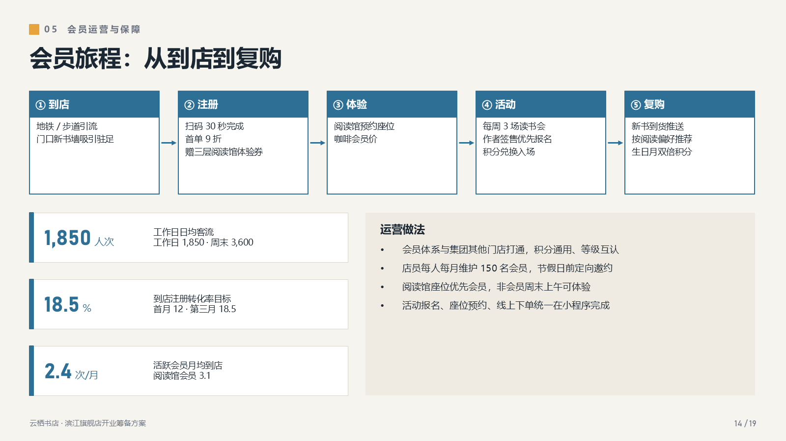
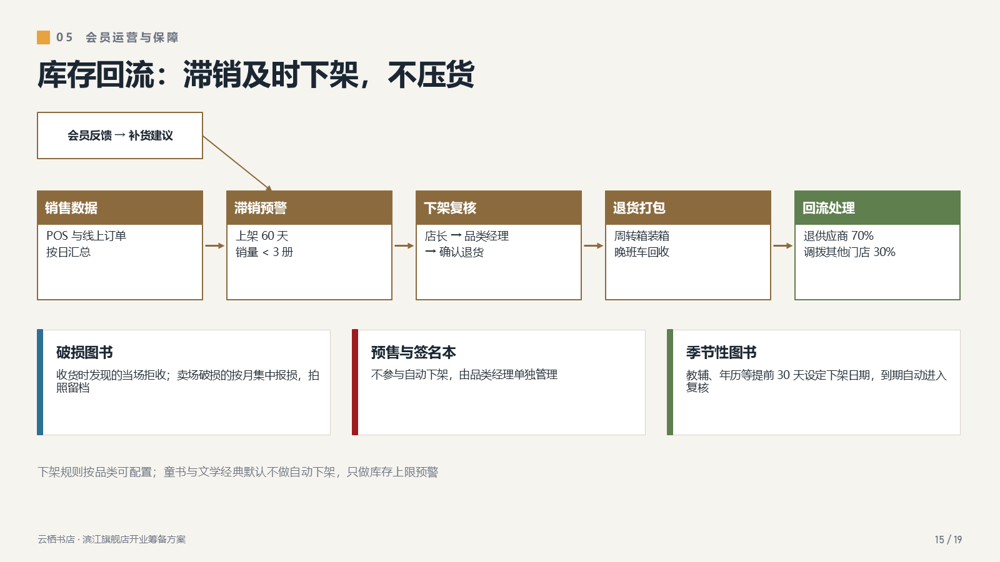
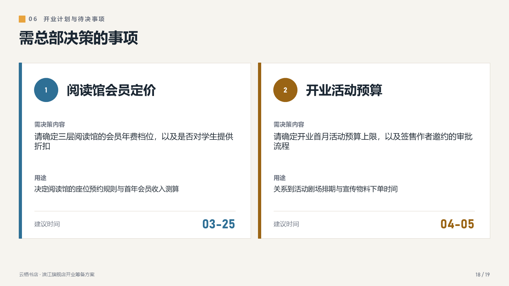

# pptx-design

用代码生成**中文汇报型 PPT**：一套调好的设计系统、19 种现成版式，再加一个出片自检。

适合这类场景：方案汇报、项目进展、筹备计划、对上级或对甲方的阶段汇报。内容以数字、分区、流程、节点、待决事项为主，要求**一眼看懂、经得起追问**。

```bash
node examples/bookstore/build.js          # 出 19 页示例 deck
python tools/check.py 输出.pptx            # 出片自检
```



> 示例是虚构的“云栖书店 · 滨江旗舰店开业筹备方案”，所有名称、数字都是编的。

---

## 目录

- [它解决什么问题](#它解决什么问题)
- [1. 安装](#1-安装)
- [2. 三分钟上手](#2-三分钟上手)
- [3. 19 种版式一览](#3-19-种版式一览)
- [4. 部件 API](#4-部件-api)
- [5. 设计系统](#5-设计系统)
- [6. 出片自检](#6-出片自检)
- [7. 导出截图，用眼睛再过一遍](#7-导出截图用眼睛再过一遍)
- [8. 踩过的坑](#8-踩过的坑)
- [9. 已知限制](#9-已知限制)

---

## 它解决什么问题

汇报 PPT 常见的疼：

| 做法 | 疼在哪 |
|---|---|
| 从公司模板手搓 | 对齐、间距全靠手拖，改一个数要翻十页；页码、提纲、页脚经常对不上 |
| AI 一键生成 | 好看但空，数字和结构撑不住追问；想改一处就得整份重来 |
| Markdown 转 PPT（Marp 等） | 适合讲技术，排不出分区图、拓扑图、双时间线这种“业务版式” |

这个工具走另一条路：**每一页都是一段 JavaScript**，版式、配色、字号都已经定好，你只需要换数据和文字。

- **改数字就是改代码里的一个值**，重新跑一遍就出新版，不存在“这页改了那页忘了”
- **页码自动算**：增删页后，页脚的“n / 总页数”自己更新
- **每页都能带演讲备注**，讲稿和 PPT 放在同一个文件里
- **出片自检**：残留标记、敏感词、页码、越界、文字溢出，一条命令查完

生成的 `.pptx` 是原生的形状、文本框、表格和图表，不是图片。拿到的人照样可以在 PowerPoint 里改。

---

## 1. 安装

需要 **Node.js 18+**：

```bash
npm install
```

依赖只有一个 [pptxgenjs](https://github.com/gitbrent/PptxGenJS)。

以下工具是**可选**的，只有自检、截图、示例配图才用得到：

```bash
pip install -r requirements.txt    # python-pptx、Pillow、matplotlib
```

截图脚本 `tools/export_png.ps1` 调用本机的 PowerPoint，因此只能在 **Windows + Office** 下使用。

---

## 2. 三分钟上手

```js
const { createKit } = require("./lib/kit");

const K = createKit({
  title: "某某项目阶段汇报",          // 文件属性
  author: "某某部门",
  footerText: "某某项目 · 阶段汇报",  // 每页左下角
});
const { pres, C, F } = K;

{
  const s = K.addSlide();
  K.header(s, "01", "项目概况", "三个数字看懂现状");
  K.stat(s, 0.5, 1.6, 3.5, "6,420", "㎡", "建筑面积");
  K.stat(s, 4.5, 1.6, 3.5, "292", "组", "书架总数", C.steel);
  K.pointRow(s, 0.5, 3.0, 12.3, 1, "要点标题", "要点说明，一两行为宜");
  K.footer(s);                       // 登记这页要画页脚，页码在 save 时统一算
  s.addNotes("演讲备注写在这里。");
}

K.save("输出.pptx");
```

最快的上手方式是**复制 `examples/bookstore/build.js`**，从中挑出要用的页，删掉其余的，再换成自己的内容。每页开头都有一行 `// ═════════ n 版式说明 ═════════` 标记，方便定位。

示例配图由 `examples/bookstore/figs.py` 生成。换成你自己的图时，把 `framedImage` 的 `ratio` 改成图片的实际宽高比即可。

---

## 3. 19 种版式一览

| # | 版式 | 适合放什么 |
|---|---|---|
| 1 | 封面：左文右线稿 | 项目名、汇报标题、单位与日期 |
| 2 | 提纲：2 × 3 编号卡 | 六个章节，前三 / 后三用两种强调色区分 |
| 3 | 大图 + 大数字 + 关键点位 + 尺寸链 | 场地、选址、现状 |
| 4 | 全宽图 + 自动排布图例 | 总平面、全景图 |
| 5 | 横向条形图 + 四张说明卡 | 面积、预算、工作量分配 |
| 6 | 竖长图 + 五个编号要点 | 剖面、层级、流程说明 |
| 7 | 图 + 超大数字 + 堆叠条 + 要点 | 一个总量及其构成 |
| 8 | 图 + 两张并排数量卡 + 规格条 | 两个对象对比 |
| 9 | 局部放大图 + 三要点 + 小表 | 细节、配置清单 |
| 10 | 超大总数 + 分批 + 双时间线 | 分批交付、两期计划 |
| 11 | 拓扑图：源 → 中心 → 五分支 | 供应网络、系统架构、组织关系 |
| 12 | 条形图 + 四张指标卡 | 预测、负荷、KPI |
| 13 | 图 + 标签说明 + 表格 | 作业安排、线路清单 |
| 14 | 五步横向流程 + 指标 + 说明框 | 用户旅程、工艺流程 |
| 15 | 流程 + 支线汇入 + 三张分类卡 | 主流程加例外处理 |
| 16 | 三列标题卡 | 三方面措施 |
| 17 | 里程碑时间线（上下交错）+ 三张卡 | 关键节点 |
| 18 | 两张大行动卡 | 需上级或甲方拍板的事项 |
| 19 | 结束页 | 致谢 |

逐页大图在 [`assets/slides/`](assets/slides/)。

| | |
|---|---|
|  |  |
|  |  |
|  |  |

---

## 4. 部件 API

`createKit()` 返回下面这些函数。坐标和尺寸单位都是**英寸**，画布为 13.333 × 7.5。

| 函数 | 作用 |
|---|---|
| `addSlide()` | 新建一页（必须用它，不要直接调 `pres.addSlide()`，否则页码会算错） |
| `header(s, 章节号, 章节名, 标题)` | 正文页标准页眉，同时设置底色 |
| `footer(s)` | 登记页脚；页码在 `save()` 时统一绘制 |
| `card(s, x, y, w, h, 底色?, 描边?)` | 卡片底 |
| `bar(s, x, y, h, 颜色)` | 卡片左侧竖色条 |
| `stat(s, x, y, w, 数字, 单位, 说明, 颜色?)` | 大数字 + 单位 + 说明 |
| `bigNumber(s, x, y, w, 数字, 单位, 颜色?, 字号?)` | 页面主角级的超大数字 |
| `numDot(s, x, y, n, 颜色?, 直径?)` | 编号圆点 |
| `pointRow(s, x, y, w, n, 标题, 说明, 颜色?, 说明高?)` | 编号圆 + 粗标题 + 灰色说明 |
| `noteCard(s, x, y, w, h, 标题, 正文, 颜色)` | 带色条的标题卡 |
| `flowBox(s, x, y, w, h, 标题, 行[], 颜色)` | 色头流程框 |
| `flowRow(s, x, y, 总宽, h, 步骤[], 颜色)` | 一行流程框 + 箭头，自动均分宽度 |
| `arrow(s, x1, y1, x2, y2, 颜色?, 线宽?)` | 任意方向的箭头线 |
| `framedImage(s, 文件, x, y, {w 或 h, ratio})` | 图片放进白底卡片，按宽高比缩放，返回 `bottom/right` 便于接排 |
| `legend(s, [[色, 文字]…], x, y, 总宽)` | 图例：按字宽自动均分一整行 |
| `hbar(s, x, y, w, h, 标签[], 值[], 颜色, 格式?)` | 横向条形图（最大值排在最上） |
| `table(s, 行[][], {x, y, w, colW, align, numCols…})` | 斑马纹表格，首行为表头 |
| `bullets(s, 条目[], {x, y, w, h, fontSize…})` | 项目符号列表 |
| `save(文件名)` | 补画所有页脚并写出文件 |

需要更细的控制时，`K.pres` 就是 pptxgenjs 的原生对象，直接用 `s.addText / addShape / addChart` 即可。示例里有一半页面就是这样写的。

---

## 5. 设计系统

**配色**：暖灰纸色底，配藏青色标题，再用三种强调色给内容分组。

| 键 | 色值 | 用途 |
|---|---|---|
| `navy` | `#1B2733` | 标题、主数字 |
| `amber` | `#E8A33D` | 第一强调（色块、图形） |
| `amberT` | `#9A6414` | 琥珀色压在浅底上的**文字版**，保证对比度 |
| `steel` | `#2E6F95` | 第二强调 |
| `sage` | `#5F7F4E` | 第三强调（绿色系） |
| `red` | `#9E1B1E` | 风险、警示 |
| `bg` / `pale` / `line` | `#F6F4EF` / `#EFEBE2` / `#D9D4C7` | 底色 / 注释条 / 描边 |

要换成公司色，改一个键就行：`createKit({ colors: { amber: "C8102E", amberT: "8E0C21" } })`。

**字体**：正文用微软雅黑，数字用 Bahnschrift（Windows 自带的等宽感数字字体，大数字很好看）。可以用 `font` / `numFont` 参数替换。

**字号梯度**：页标题 28，卡片标题 13.5–15，正文 10.5–12.5，大数字 30 / 44 / 60，页脚 9。

**几条版式规则**，示例里都遵守了：
- 页边距 0.5 in，内容区宽 12.3 in
- 同一行卡片等宽等距。三列卡片是 `x = 0.5 + i × 4.21, w = 3.91`，两列是 `x = 0.5 + i × 6.265, w = 6.065`
- 每页只有一个主角：一张图、一个大数字或一张图表，其余都是配角
- 标题写结论，不写话题：用“门店实测 86 m × 32 m”，不用“门店情况”

---

## 6. 出片自检

```bash
python tools/check.py 输出.pptx --ban 敏感词.txt
```

| 检查项 | 级别 |
|---|---|
| 残留标记：`TODO` `XXX` `{{ }}` `待补` `待定` `??` | 错误 |
| 敏感词：`--ban` 文件每行一个词，**中英文都查，正文和演讲备注都查** | 错误 |
| 页码：页脚 `n / N` 与实际页序、总页数不一致 | 错误 |
| 越界：任何元素超出画布 | 错误 |
| 文字可能溢出：按字宽粗估的高度超过文本框 | 提示 |
| 缺演讲备注（首尾页除外） | 提示 |

有错误时退出码为 1，可以接进脚本或 CI。

**敏感词文件建议自己维护一份，不要放进仓库。** 对外汇报前，把客户名、内部代号、底价、垫资、“内部”“草稿”这类词都列进去。演讲备注最容易漏，因为它不显示在页面上，但文件发出去以后对方一打开就能看到。

自检**查不了**的：颜色对比度、元素相互遮挡、图文是否对应、数字在全文中口径是否一致。这些要看图，见下一节。

---

## 7. 导出截图，用眼睛再过一遍

```powershell
powershell -File tools/export_png.ps1 输出.pptx shots 1600   # 每页导出 PNG
python tools/contact_sheet.py shots                          # 拼成 2×2 联系表
```

截图用的是 PowerPoint 本身的渲染，所见即所得，比 LibreOffice 转出来的更可信。联系表一张放四页，适合逐张扫：对齐、留白、折行、有没有哪一行只剩一个字。

---

## 8. 踩过的坑

这些都是真实返工过的问题，已经处理进了 `kit.js` 或示例里：

- **图例手工排总会挤**。每个图例项宽度不同，平均分配时长词会顶到下一项。`legend()` 先按字宽估算每项的宽度，再均分剩余空间。9 号字下，中文按每字 0.125 in 估，西文按 0.078 in 估。估小了文字会被截断，所以宁可估大一点。
- **pptxgenjs 的斜线箭头**：`LINE` 只有 x/y/w/h，方向要靠 `flipH / flipV` 表达。`arrow()` 已经封装好了。
- **表格 `margin` 的单位是英寸**，照着文本框的习惯写成磅，单元格会被撑爆。
- **琥珀色直接当文字色，对比度不够**。所以另设了 `amberT` 作为文字版。
- **插页后要手改十处页码**。现在由 `save()` 统一计算。
- **演讲备注里的内部信息**。页面上删干净了，备注里还留着，这种事最容易出。自检会连备注一起查。
- **说明卡里一行只剩一两个字**，看着像排版错误。解决办法是改措辞，不要改框宽。改框宽会连带破坏整行卡片的对齐。

---

## 9. 已知限制

- **字体**：Mac 或没装 Office 的电脑上缺微软雅黑和 Bahnschrift，PowerPoint 会用替代字体，字宽一变可能折行。给别人发文件前，建议另存一份 PDF。
- **版式是“写死坐标”的**：这是有意为之，换来的是像素级可控。代价是内容明显变长时要自己调坐标或字号，自检的“可能溢出”会提醒你。
- **不是模板引擎**：没有 JSON 进、PPT 出那种配置层。页面就是代码，想要什么就写什么。
- 截图脚本只支持 Windows + PowerPoint。

---

## License

MIT
